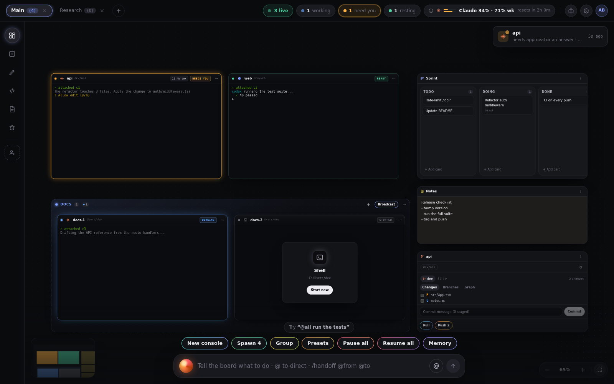

# OpenBoard

[](https://github.com/Podvossto/openboard/actions/workflows/ci.yml)

An infinite pan/zoom board where every node is a real CLI coding agent (Claude Code, Codex, any shell) running in a real terminal.



## What it does

- **Consoles are real terminals.** Each one is a PTY (ConPTY on Windows) with xterm.js on top. The CLIs run unmodified and use their own login. Claude Code and Codex have built-in launchers; a catalog adds OpenCode, Qwen Code, Cursor CLI, Amp, Goose, Crush, Grok CLI, Kimi CLI and Droid, and any program can be a custom console.
- **Live status per console:** working, resting, needs you, exited. Needs-you shows a notification and a counter in the top bar.
- **Resume.** Claude consoles get a pre-assigned session id and can be resumed after a restart; Codex uses `codex resume --last`. Scrollback is replayed when the UI reattaches.
- **Workspaces, groups and sections.** Several boards as tabs, consoles grouped with a broadcast box, labelled sections, a freehand ink layer, and per-workspace memory that can be handed to Claude consoles as a system prompt.
- **Tiles next to the consoles:** note, checklist, kanban, calendar, image, web (embedded, or a native child webview for sites that block iframes), git (changes, branches, graph, commit/pull/push) and a code editor with a file tree.
- **Command bar.** `@name` to direct a message at a console, `/handoff @from @to` to summarise one console's transcript and pass it on, and a free-form mode where Claude turns an instruction into a plan over your consoles.
- **Orchestrator.** A console can be started as a lead that gets a built-in MCP server: it can list consoles, send to and read from them, spawn new ones, and edit the kanban, checklist and calendar tiles you linked to it. The board updates live.
- **Loops.** Re-send a prompt to a console on an interval, when it has been idle for a while, or when its output matches some text.
- **Presets** for groups of consoles, plus Skills and MCP server management for Claude Code and Codex.
- **Accounts.** Profiles that switch a console between a subscription login (separate `CLAUDE_CONFIG_DIR` / `CODEX_HOME`) and an Anthropic-compatible provider with an API key (Z.ai, Zhipu BigModel, Moonshot Kimi, DeepSeek, MiniMax, OpenRouter).
- **Usage panel.** Claude plan limits (5-hour and weekly), Codex rate limits, and token analytics computed from local session logs.

## How it works

```
keystrokes: xterm.js -> write_console -> PTY
output:     PTY reader thread -> scrollback ring + per-console Tauri Channel -> xterm.js
status:     CLI hook -> `openboard hook` -> loopback HTTP server (token) -> state machine -> UI
```

- **Status via hooks.** Claude Code is launched with `--settings <file written by the app>` whose hooks run `openboard hook`, which posts the event to a server on `127.0.0.1` protected by a per-run token. Your own `~/.claude/settings.json` is not modified. Other CLIs get an input/output heuristic instead of hooks.
- **Orchestrator.** The MCP server is also on loopback and token-protected. Lead consoles are started with an MCP config pointing at it and an allow-list of its tools.
- **Persistence.** The workspace is a JSON file in the app data directory, written atomically with 5 rotating backups; a corrupt file falls back to a backup.
- **Stack.** Tauri 2 shell (`src-tauri`), UI-agnostic Rust logic with tests in `crates/board-core`, React 19 + TypeScript + Vite + Tailwind 4 front end, React Flow for the canvas.

## Requirements

- Windows 10 or 11 is the supported platform. It is what the installer targets and what the author uses. WebView2 is preinstalled on both.
- The agent CLIs you want to run (for example `claude`, `codex`) installed and on `PATH`. OpenBoard does not install or log in to them for you.
- Linux and macOS are untested. The code has macOS and non-Windows branches and the Rust and web checks run on Linux in CI, but no installer is built for them and on Linux the API-key store falls back to memory only (keys are lost on exit).

## Install

Download `OpenBoard_<version>_x64-setup.exe` from the [Releases](https://github.com/Podvossto/openboard/releases) page and run it. It installs per user and needs no admin rights.

The installer is not code-signed, so Windows SmartScreen will say "Windows protected your PC". Click **More info**, then **Run anyway**. There is no auto-update; install a newer release over the old one.

## Build from source

Prerequisites: Node 22+, Rust stable (pinned by `rust-toolchain.toml`), and on Windows the MSVC build tools.

```powershell
npm ci
npm run tauri dev                   # run the app with hot reload
npx tauri build --bundles nsis      # installer in target/release/bundle/nsis/
```

On Linux the desktop shell also needs `libwebkit2gtk-4.1-dev libgtk-3-dev librsvg2-dev libayatana-appindicator3-dev libssl-dev`.

Checks (the same ones CI runs):

```bash
npm run check                        # typecheck + eslint + vitest
cargo fmt --all --check
cargo clippy -p board-core -- -D warnings
cargo test -p board-core             # includes real PTY integration tests
```

## Develop the UI in a browser

`npx vite --mode mock` serves the UI with a fake backend (`src/dev/tauri-mock.ts`): sample consoles, tiles, usage numbers, git data. No Tauri or Rust needed. `scripts/ui-smoke.py` is a Playwright smoke test against it (`pip install playwright`).

## Project layout

```
crates/board-core/   PTY sessions, status machine, hook server, MCP server, launch specs,
                     profiles/keyring, usage and analytics, git, persistence (Rust, tested)
src-tauri/           Tauri 2 glue: IPC commands, event bridge, native web tile, app state
src/                 React UI: board/, console/, tiles/, dock/ (command bar), loops/,
                     extensions/, settings/, usage/, store/ (zustand), lib/ (typed IPC)
scripts/             bump-version.py, ci-win-native-deps.ps1, ui-smoke.py
docs/                RELEASING.md
```

## Privacy

- No telemetry, no analytics, no crash reporting. The app has no server of its own.
- The agent CLIs talk to their own providers as they normally do; OpenBoard does not proxy that traffic.
- **API keys** for provider profiles are stored in Windows Credential Manager (macOS Keychain) under the service name `openboard`, never in the workspace file. They are passed to a console as environment variables when it starts.
- **Usage panel, exactly what is read:**
  - `~/.claude/.credentials.json` (or the profile's `CLAUDE_CONFIG_DIR`): read-only, to get the Claude Code OAuth token, which is sent to `api.anthropic.com` to ask for plan usage. The token is never refreshed, stored or logged. `~/.claude.json` is read for the account email and plan label shown in settings.
  - `$CODEX_HOME/auth.json` (default `~/.codex`): read-only, only to tell whether you are logged in with a ChatGPT account or an API key; no value is sent anywhere. Codex rate limits come from its session logs in `$CODEX_HOME/sessions`.
  - Token analytics read the local session logs (`<claude config>/projects/**/*.jsonl`, `$CODEX_HOME/sessions`). Nothing is uploaded.
  - For a Z.ai provider profile, the profile's API key is sent to `api.z.ai` to fetch its quota.
- The command bar's free-form mode and the loop goal check run `claude -p` with your own login; board contents you reference are part of that prompt.
- The web tile loads whatever URL you enter in a separate webview that has no access to the app's IPC.

## License

[MIT](LICENSE). See [CONTRIBUTING.md](CONTRIBUTING.md) to help out.
